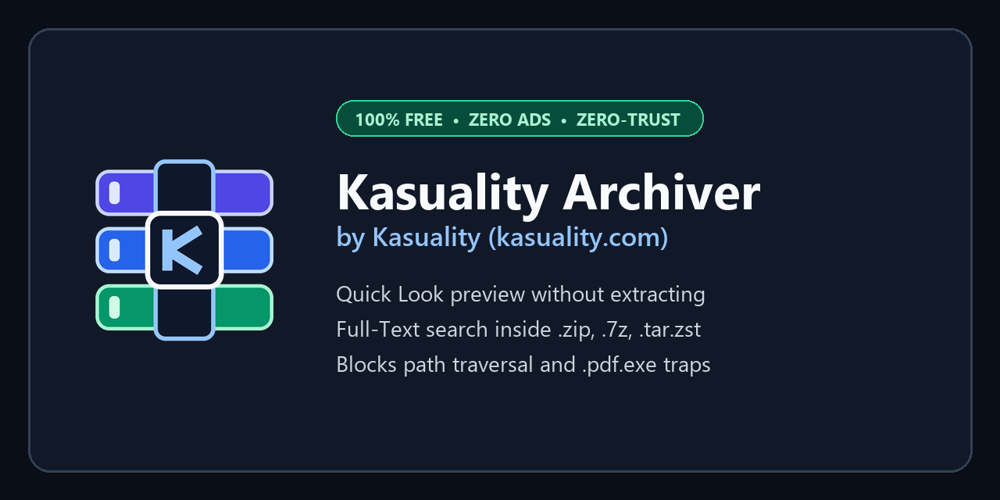

# Kasuality Archiver — by Kasuality

[Download-Seite (OS-Erkennung)](https://kasualityitalia-create.github.io/kasuality-archiver/) | [Mobile Web-App öffnen (Android / iOS / iPadOS)](https://kasualityitalia-create.github.io/kasuality-archiver/app.html) | [Neueste Desktop-Releases (v1.0.1)](https://github.com/kasualityitalia-create/kasuality-archiver/releases/latest)

**Sprachen:** [English](README.md) | [Italiano](README.it.md) | [Français](README.fr.md) | [Español](README.es.md) | Deutsch

**Kasuality Archiver** ist ein 100% kostenloser, werbefreier Archiv-Manager ohne Kauf-Popups, entwickelt von [Kasuality](https://www.kasuality.com/de/).

## Hauptvorteile
- **100% Kostenlos, Keine Werbung, Keine Popups**: keine Testphase-Erinnerungen und keine Zusatzsoftware.
- **Sofortige Quick Look Vorschau**: Text, Code und Bilder direkt im Speicher ansehen, ohne auf die Festplatte zu entpacken.
- **Zero-Trust Sicherheitsscan**: erkennt Path-Traversal (`../../`), doppelte Endungen (`.pdf.exe`) und Zip-Bomben vor dem Entpacken.
- **Volltextsuche in Archiven**: Suchbegriffe oder Codezeilen innerhalb komprimierter Dateien finden, ohne sie auszupacken.
- **Alles oder nur Auswahl entpacken**: das gesamte Archiv oder nur ausgewählte Dateien entpacken (`Strg + Klick` oder Rechtsklick -> *Nur ausgewählte entpacken*).
- **Moderne Formate + Smart Dev Exclude**: unterstützt `.zip`, `.7z`, `.tar.zst` (Zstandard), `.tar.gz`, `.tar`, `.tar.bz2`, `.tar.xz`, `.zst` und überspringt `node_modules`, `.git`, `__pycache__`, `dist` sowie `.venv`.
- **SHA-256 Prüfung + integrierte `(i)` Anleitung in 5 Sprachen** (`EN`, `IT`, `FR`, `ES`, `DE`).

## Nutzung auf Smartphone, Tablet und im Browser (ohne Installation)
Nutze **Kasuality Archiver Web** direkt im Browser auf **Android, iPhone, iPad oder PC** (100% lokale Verarbeitung ohne Server-Upload):
- Öffnen: [https://kasualityitalia-create.github.io/kasuality-archiver/app.html](https://kasualityitalia-create.github.io/kasuality-archiver/app.html)

## Start aus dem Quellcode (Windows, macOS, Linux)

```bash
pip install -r requirements.txt
python app.py
```

## Automatisierte Tests

```bash
python -m unittest discover -s tests -v
```

## Lizenz
Veröffentlicht unter der [MIT-Lizenz](LICENSE) — Copyright (c) 2026 [Kasuality](https://www.kasuality.com/de/).
