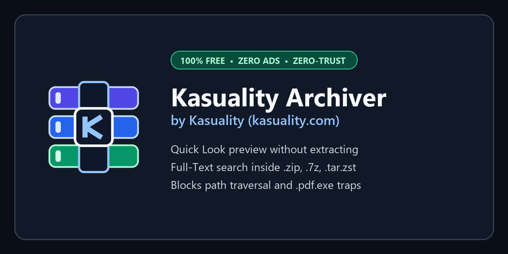

# Kasuality Archiver — by Kasuality

[Página de Descarga (Detección OS)](https://kasualityitalia-create.github.io/kasuality-archiver/) | [Abrir Web App Móvil (Android / iOS / iPadOS)](https://kasualityitalia-create.github.io/kasuality-archiver/app.html) | [Últimas Versiones Desktop (v1.0.1)](https://github.com/kasualityitalia-create/kasuality-archiver/releases/latest)

**Idiomas:** [English](README.md) | [Italiano](README.it.md) | [Français](README.fr.md) | Español | [Deutsch](README.de.md)

**Kasuality Archiver** es un gestor de archivos 100% gratuito, sin anuncios y sin ventanas molestas, creado por [Kasuality](https://www.kasuality.com/es/).

## Ventajas principales
- **100% Gratis, Sin Anuncios, Sin Ventanas Molestas**: sin avisos de compra ni programas extra.
- **Quick Look instantáneo**: vista previa de texto, código e imágenes en memoria sin extraer en disco.
- **Escaneo de Seguridad Zero-Trust**: detecta path traversal (`../../`), dobles extensiones sospechosas (`.pdf.exe`) y bombas zip antes de extraer.
- **Búsqueda de Texto Completo dentro de archivos**: busca palabras o líneas de código sin descomprimir.
- **Extracción total o selectiva**: extrae todo o solo los elementos seleccionados (`Ctrl + clic` o clic derecho -> *Extraer solo seleccionados*).
- **Formatos modernos + Smart Dev Exclude**: compatible con `.zip`, `.7z`, `.tar.zst` (Zstandard), `.tar.gz`, `.tar`, `.tar.bz2`, `.tar.xz`, `.zst`, omitiendo `node_modules`, `.git`, `__pycache__`, `dist` y `.venv`.
- **Verificación SHA-256 + Guía `(i)` en 5 idiomas** (`EN`, `IT`, `FR`, `ES`, `DE`).

## Uso en Móvil, Tablet y Navegador (sin instalación)
Usa **Kasuality Archiver Web** directamente desde el navegador en **Android, iPhone, iPad o PC** (procesamiento 100% local, sin subir archivos a servidores):
- Abrir: [https://kasualityitalia-create.github.io/kasuality-archiver/app.html](https://kasualityitalia-create.github.io/kasuality-archiver/app.html)

## Ejecutar desde el código fuente (Windows, macOS, Linux)

```bash
pip install -r requirements.txt
python app.py
```

## Pruebas automáticas

```bash
python -m unittest discover -s tests -v
```

## Licencia
Publicado bajo [Licencia MIT](LICENSE) — Copyright (c) 2026 [Kasuality](https://www.kasuality.com/es/).
