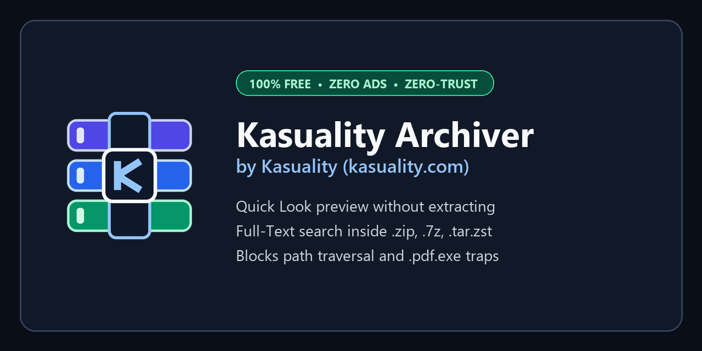

# Kasuality Archiver — by Kasuality

[Page de Téléchargement (Détection OS)](https://kasualityitalia-create.github.io/kasuality-archiver/) | [Ouvrir Web App Mobile (Android / iOS / iPadOS)](https://kasualityitalia-create.github.io/kasuality-archiver/app.html) | [Dernières Versions Desktop (v1.0.1)](https://github.com/kasualityitalia-create/kasuality-archiver/releases/latest)

**Langues :** [English](README.md) | [Italiano](README.it.md) | Français | [Español](README.es.md) | [Deutsch](README.de.md)

**Kasuality Archiver** est un gestionnaire d'archives 100% gratuit, sans publicité et sans fenêtre intrusive, conçu par [Kasuality](https://www.kasuality.com/fr/).

## Avantages clés
- **100% Gratuit, Zéro Pub, Zéro Popup** : aucun écran d'achat ni logiciel indésirable.
- **Quick Look instantané** : prévisualisez texte, code et images en mémoire sans extraction sur disque.
- **Analyse Sécurité Zero-Trust** : détecte le path traversal (`../../`), les doubles extensions suspectes (`.pdf.exe`) et les bombes zip avant l'extraction.
- **Recherche Plein Texte dans les archives** : trouvez des mots-clés ou lignes de code sans décompresser.
- **Extraction complète ou sélective** : extrayez tout ou uniquement la sélection (`Ctrl + clic` ou clic droit -> *Extraire uniquement la sélection*).
- **Formats modernes + Smart Dev Exclude** : supporte `.zip`, `.7z`, `.tar.zst` (Zstandard), `.tar.gz`, `.tar`, `.tar.bz2`, `.tar.xz`, `.zst`, en ignorant `node_modules`, `.git`, `__pycache__`, `dist` et `.venv`.
- **Vérification SHA-256 + Guide `(i)` en 5 langues** (`EN`, `IT`, `FR`, `ES`, `DE`).

## Utilisation sur Mobile, Tablette et Navigateur (sans installation)
Utilisez **Kasuality Archiver Web** directement dans votre navigateur sur **Android, iPhone, iPad ou PC** (traitement 100% local, aucun envoi vers un serveur) :
- Ouvrir : [https://kasualityitalia-create.github.io/kasuality-archiver/app.html](https://kasualityitalia-create.github.io/kasuality-archiver/app.html)

## Lancement depuis les sources (Windows, macOS, Linux)

```bash
pip install -r requirements.txt
python app.py
```

## Tests unitaires

```bash
python -m unittest discover -s tests -v
```

## Licence
Publié sous [Licence MIT](LICENSE) — Copyright (c) 2026 [Kasuality](https://www.kasuality.com/fr/).
