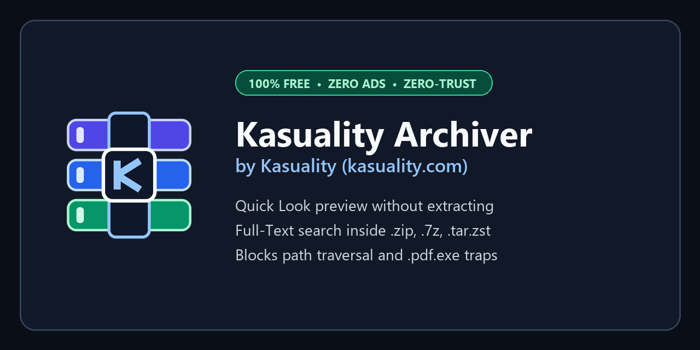

# Kasuality Archiver — by Kasuality

[Pagina Download (Rilevamento OS)](https://kasualityitalia-create.github.io/kasuality-archiver/) | [Apri Web App Mobile (Android / iOS / iPadOS)](https://kasualityitalia-create.github.io/kasuality-archiver/app.html) | [Ultime Release Desktop (v1.0.1)](https://github.com/kasualityitalia-create/kasuality-archiver/releases/latest)

**Lingue:** [English](README.md) | Italiano | [Français](README.fr.md) | [Español](README.es.md) | [Deutsch](README.de.md)

**Kasuality Archiver** è un gestore di archivi 100% gratuito, senza pubblicità e senza popup di licenza, realizzato da [Kasuality](https://www.kasuality.com/it/).

## Cosa offre in più rispetto ai tool tradizionali
- **100% Gratis, Zero Ads, Zero Nag Screen**: nessun popup di acquisto né programmi extra.
- **Quick Look istantaneo**: anteprima di testo, codice e immagini direttamente in memoria senza estrarre su disco.
- **Scansione Sicurezza Zero-Trust**: rileva path traversal (`../../`), doppie estensioni sospette (es. `.pdf.exe`) e zip bomb prima di estrarre.
- **Ricerca Full-Text negli archivi**: cerca parole o righe di codice dentro i file compressi senza scompattarli.
- **Estrazione completa o selettiva**: estrai tutto l'archivio oppure solo i file selezionati (`Ctrl + clic` o tasto destro -> *Estrai solo selezionati*).
- **Formati moderni + Smart Dev Exclude**: supporta `.zip`, `.7z`, `.tar.zst` (Zstandard), `.tar.gz`, `.tar`, `.tar.bz2`, `.tar.xz`, `.zst`, saltando in automatico `node_modules`, `.git`, `__pycache__`, `dist` e `.venv`.
- **Verifica SHA-256 + Legenda `(i)` in 5 lingue** (`EN`, `IT`, `FR`, `ES`, `DE`).

## Uso da Smartphone, Tablet e Browser (senza installazione)
Usa **Kasuality Archiver Web** direttamente dal browser su **Android, iPhone, iPad o PC** (elaborazione 100% locale, nessun file inviato ai server):
- Apri: [https://kasualityitalia-create.github.io/kasuality-archiver/app.html](https://kasualityitalia-create.github.io/kasuality-archiver/app.html)

## Avvio da sorgente (Windows, macOS, Linux)

```bash
pip install -r requirements.txt
python app.py
```

## Test automatici

```bash
python -m unittest discover -s tests -v
```

## Licenza
Rilasciato sotto [Licenza MIT](LICENSE) — Copyright (c) 2026 [Kasuality](https://www.kasuality.com/it/).
